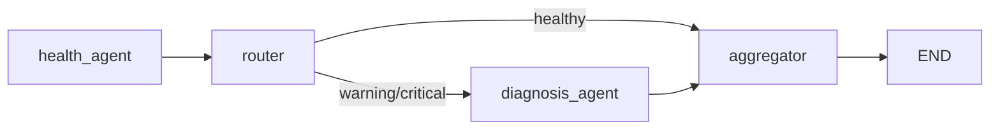
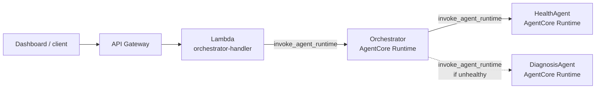

# Architecture

## Agent logic

### HealthAgent — deterministic classification, no LLM

[`src/agents/health_agent.py`](src/agents/health_agent.py) is pure threshold-based logic,
no LLM, no external calls in the common case:

1. **Detect anomalies** — for each sensor in `current_reading.readings`, compare its
   `value` against its `normal_range`. Out-of-range sensors become anomaly strings, e.g.
   `"temperature_high: 98°C (normal: 20-95°C)"`.
2. **Score degradation** — each anomaly's severity (0.10/0.20/0.35/0.50) is based on how
   far outside `normal_range` it is (percentage deviation), then summed and capped at 1.0.
3. **Classify** — `degradation_score < 0.15` → `healthy`, `< 0.50` → `warning`, else
   `critical`.

Output: `health_status`, `degradation_score`, `anomalies` — this is exactly what the
`router` node in the graph switches on.

### DiagnosisAgent — 4-step rule-first, LLM-as-fallback

[`src/agents/diagnosis_agent.py`](src/agents/diagnosis_agent.py) only runs when
`health_status` is `warning`/`critical`. It follows 4 steps:

1. **Pattern match** — equipment-specific rules (`PUMP`/`MOTOR`/`COMPRESSOR`/`GENERATOR`)
   match the anomaly list against known failure signatures, producing a `diagnosis`,
   `confidence` (0.0–1.0), a recommended `action`, and a `severity`.
2. **Critical escalation** — if `health_status == 'critical'`, the action is always
   force-escalated to `URGENT_REPAIR` regardless of the rule match (business rule: a
   critical reading always means an immediate work order).
3. **LLM fallback** — only when `confidence < 0.85` *and* the device isn't critical, the
   rule's suggestion is sent to an LLM ([`src/llm/llm_client.py`](src/llm/llm_client.py),
   Azure OpenAI) to verify/override the diagnosis, action, and confidence. High-confidence
   rule matches skip the LLM call entirely (cost optimization, same idea as the `router`
   node skipping DiagnosisAgent for healthy devices).
4. **Execute the action** — each `action` maps to a different set of real MCP tool calls
   via `GatewayClient`:
   - `URGENT_REPAIR` → `create-work-order` (emergency work order)
   - `SCHEDULE_MAINTENANCE` → `get-spare-parts` (mandatory availability check) →
     `schedule-maintenance` (writes to DynamoDB) → `create-work-order`
   - `MONITOR_ONLY` → no tool calls, just a logged recommendation

Output includes `diagnosis`, `confidence`, `confidence_rule_based` (the pre-LLM value, so
you can see whether/how the LLM changed the outcome), `action`, `action_taken`,
`tool_results`, and `llm_used`.

### Data flow

Sensor readings come from `data/generated/` (synthetic per-device time series), loaded by
`DeviceLoader` ([`src/utils/`](src/utils)). The Orchestrator reads a device's latest
reading, hands it to HealthAgent, and — depending on the graph's `router` decision —
optionally to DiagnosisAgent. See `WorkflowState` in
[`src/graph/workflow.py`](src/graph/workflow.py) for the exact fields passed between
nodes.

## The agent graph (LangGraph)

Every device reading flows through the same 4-node graph, regardless of whether it runs
locally or on AWS:



- **health_agent**: pure classification — no LLM, no tools. Returns `health_status`
  (healthy/warning/critical), a `degradation_score`, and any anomalies.
- **router**: a plain `if` check on `health_status` — no LLM call. This is the cost
  optimization: only unhealthy devices proceed to the (more expensive) diagnosis step.
- **diagnosis_agent**: runs only when routed. Determines root cause/action, and — for
  `SCHEDULE_MAINTENANCE` actions — calls real MCP tools (spare parts check, maintenance
  scheduling, work order creation).
- **aggregator**: merges whatever ran into the final response shape.

This graph is defined twice, with identical topology and routing logic:
- [`src/graph/workflow.py`](src/graph/workflow.py) — local version, calls the other
  agents over plain HTTP (`httpx`) at `http://health-agent:8001` / `http://diagnosis-agent:8002`.
- [`src/graph/workflow_agentcore.py`](src/graph/workflow_agentcore.py) — AWS version,
  calls the other agents via `boto3` `invoke_agent_runtime()` against their AgentCore
  Runtime ARNs instead of HTTP.

Only the transport differs. Adding a node, changing routing logic, or adding a new
field to the shared state needs to happen in whichever file matches your deployment
target (or both, if you want both to support it).

## Two ways to run the same agents

| | Local (Docker Compose) | AWS (AgentCore Runtime) |
|---|---|---|
| Entry point | `src/services/<agent>/app.py` (FastAPI) | `src/services/<agent>/handler.py` (`BedrockAgentCoreApp`) |
| Transport between agents | HTTP (`httpx`) | `boto3.invoke_agent_runtime()` |
| Dockerfile | `deployment/docker-compose/<agent>.Dockerfile` | `deployment/agentcore-runtime/<agent>.Dockerfile` |
| Ports | 8000/8001/8002, path `/health` | 8080, paths `/invocations` + `/ping` |
| Started via | `docker-compose up` | Deployed once via `scripts/deploy_to_agentcore_boto3.py`, then invoked by AWS |

Each `handler.py` is self-contained — it *is* the `BedrockAgentCoreApp` HTTP server,
there's no separate wrapper script:

```python
from bedrock_agentcore.runtime import BedrockAgentCoreApp
app = BedrockAgentCoreApp()

@app.entrypoint
def invoke(payload):
    ...
    return {"statusCode": 200, "body": result}

if __name__ == "__main__":
    app.run(port=8080)
```

## Production request flow (AWS)



The Orchestrator is the only agent with its own public Lambda + API Gateway in front of
it (`functions/lambda_orchestrator_handler.py`). HealthAgent and DiagnosisAgent are never
called directly by anything public — they're only reached as nested `invoke_agent_runtime`
calls made from inside the Orchestrator's own LangGraph workflow.

Each AgentCore Runtime session runs in its own isolated microVM, torn down after AWS's
default idle timeout (15 minutes) or max lifetime (8 hours) — this project doesn't
override either value, so both are AWS's defaults.

## MCP tools, Gateway, Cognito, DynamoDB — shared, unchanged

These pieces are **existing, already-deployed AWS infrastructure**, shared by every
deployment mode (local or AgentCore) and every team. This branch does not create,
redeploy, or reconfigure any of them:

- **AgentCore Gateway** — real endpoint in `.agentcore.env` (`GATEWAY_URL`). Agents call
  it via [`src/gateway/client.py`](src/gateway/client.py); it routes to the actual tool
  implementations.
- **MCP tools** (3 total): `get_spare_parts` and `schedule_maintenance` (real AWS Lambda
  functions, `tools/lambdas/`), and `create_work_order` (a real App Runner/ECS HTTP
  service).
- **Cognito** — used for Gateway token auth (`client_credentials` grant). Config lives in
  `.agentcore.env`.
- **DynamoDB** — real tables (e.g. `agentic-maintenance-schedule`), written to by the
  Lambda tools. There is no local/mock DynamoDB — local Docker Compose containers use
  your host's real AWS credentials (`~/.aws` mounted read-only) to hit the same tables
  AgentCore Runtime deployments use.

Because all of the above is shared, real infrastructure, teams should namespace test data
(e.g. a device-ID prefix) rather than assume isolated state per team.

## What's intentionally not in this branch

- **Memory service** — not wired into the live handlers upstream; excluded here rather
  than half-finished.
- **React dashboard** — the local Jinja2 + FastAPI dashboard (`src/dashboard/`) is the
  only dashboard in this branch.
- **CodeBuild deployment pipeline** — out of scope for now; `scripts/deploy_to_agentcore_boto3.py`
  (direct boto3, no CodeBuild) is the supported path.
