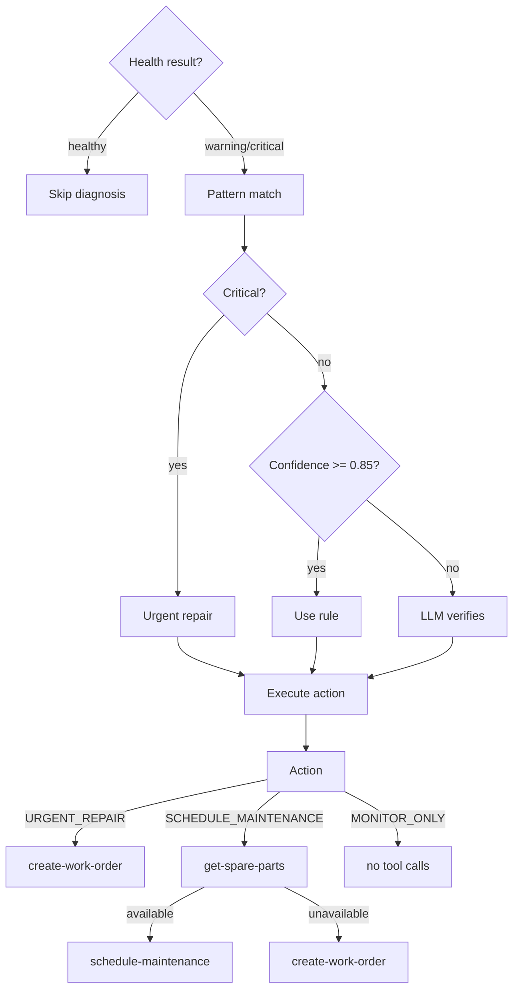
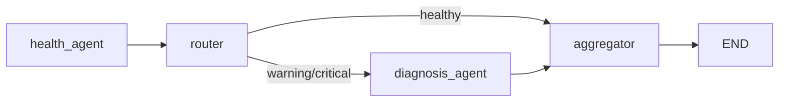

# Architecture

## Agent logic

### HealthAgent — deterministic classification, no LLM

[`src/agents/health_agent.py`](src/agents/health_agent.py) is pure threshold-based logic,
no LLM, no external calls in the common case:

1. **Detect anomalies** — for each sensor in `current_reading.readings`, compare its
   `value` against its `normal_range`. Out-of-range sensors become anomaly strings, e.g.
   `"temperature_high: 98°C (normal: 20-95°C)"`.
2. **Score degradation** — each anomaly's severity (0.10/0.20/0.35/0.50) is based on how
   far outside `normal_range` it is (percentage deviation), then summed and capped at 1.0.
3. **Classify** — `degradation_score < 0.15` → `healthy`, `< 0.50` → `warning`, else
   `critical`.

Output: `health_status`, `degradation_score`, `anomalies` — this is exactly what the
`router` node in the graph switches on.

### DiagnosisAgent — 4-step rule-first, LLM-as-fallback

[`src/agents/diagnosis_agent.py`](src/agents/diagnosis_agent.py) only runs when
`health_status` is `warning`/`critical`. It follows 4 steps:



1. **Pattern match** — each equipment type has its own method
   (`_match_pump_patterns`/`_match_motor_patterns`/`_match_compressor_patterns`/
   `_match_generator_patterns` in
   [`src/agents/diagnosis_agent.py`](src/agents/diagnosis_agent.py)) that is just a
   chain of `if`/`elif` checks against the anomaly strings. Each branch's confidence is
   a **number someone typed in by hand**, not computed at runtime — e.g. this is the
   actual PUMP logic:
   ```python
   if 'temperature_high' in anomaly and '98' in anomaly:
       if 'vibration' in anomaly:
           return {'diagnosis': 'Pump cavitation with bearing failure', 'confidence': 0.96, ...}
   if 'vibration' in anomaly:
       return {'diagnosis': 'Elevated vibration - possible wear', 'confidence': 0.72, ...}
   return {'diagnosis': 'Minor anomalies detected', 'confidence': 0.60, ...}
   ```
2. **Critical escalation** — if `health_status == 'critical'`, the action is always
   force-escalated to `URGENT_REPAIR` regardless of the rule match (business rule: a
   critical reading always means an immediate work order).
3. **LLM fallback** — only when `confidence < 0.85` *and* the device isn't critical, the
  rule's suggestion is sent to an LLM ([`src/llm/llm_client.py`](src/llm/llm_client.py),
  Amazon Bedrock Frankfurt inference profile `eu.amazon.nova-lite-v1:0`) to verify/override the diagnosis, action, and
   confidence. High-confidence rule matches skip the LLM call entirely (cost
   optimization, same idea as the `router` node skipping DiagnosisAgent for healthy
   devices).
4. **Execute the action** — each `action` maps to a different set of real MCP tool calls
   via `GatewayClient`:
   - `URGENT_REPAIR` → `create-work-order` (emergency work order)
   - `SCHEDULE_MAINTENANCE` → always calls `get-spare-parts` first (part type guessed from
     the anomaly, e.g. vibration → bearing), **then forks**: parts available →
     `schedule-maintenance` (preventive, 7 days out); parts NOT available →
     `create-work-order` instead (high-priority procurement request) — never both
     `schedule-maintenance` and `create-work-order` in the same call.
   - `MONITOR_ONLY` → no tool calls, just a logged recommendation

Output includes `diagnosis`, `confidence`, `confidence_rule_based` (the pre-LLM value, so
you can see whether/how the LLM changed the outcome), `action`, `action_taken`,
`tool_results`, and `llm_used`.

### Data flow

Sensor readings come from `data/generated/` (synthetic per-device time series), loaded by
`DeviceLoader` ([`src/utils/`](src/utils)). The Orchestrator reads a device's latest
reading, hands it to HealthAgent, and — depending on the graph's `router` decision —
optionally to DiagnosisAgent. See `WorkflowState` in
[`src/graph/workflow.py`](src/graph/workflow.py) for the exact fields passed between
nodes.

## The agent graph (LangGraph)

Every device reading flows through the same 4-node graph, regardless of whether it runs
locally or on AWS:



- **health_agent**: pure classification — no LLM, no tools. Returns `health_status`
  (healthy/warning/critical), a `degradation_score`, and any anomalies.
- **router**: a plain `if` check on `health_status` — no LLM call. This is the cost
  optimization: only unhealthy devices proceed to the (more expensive) diagnosis step.
- **diagnosis_agent**: runs only when routed. Determines root cause/action, and — for
  `SCHEDULE_MAINTENANCE` actions — calls real MCP tools (spare parts check, maintenance
  scheduling, work order creation).
- **aggregator**: merges whatever ran into the final response shape.

This graph is defined twice, with identical topology and routing logic:
- [`src/graph/workflow.py`](src/graph/workflow.py) — local version, calls the other
  agents over plain HTTP (`httpx`) at `http://health-agent:8001` / `http://diagnosis-agent:8002`.
- [`src/graph/workflow_agentcore.py`](src/graph/workflow_agentcore.py) — AWS version,
  calls the other agents via `boto3` `invoke_agent_runtime()` against their AgentCore
  Runtime ARNs instead of HTTP.

Only the transport differs. Adding a node, changing routing logic, or adding a new
field to the shared state needs to happen in whichever file matches your deployment
target (or both, if you want both to support it).

## Two ways to run the same agents

| | Local (Docker Compose) | AWS (AgentCore Runtime) |
|---|---|---|
| Entry point | `src/services/<agent>/app.py` (FastAPI) | `src/services/<agent>/handler.py` (`BedrockAgentCoreApp`) |
| Transport between agents | HTTP (`httpx`) | `boto3.invoke_agent_runtime()` |
| Dockerfile | `deployment/docker-compose/<agent>.Dockerfile` | `deployment/agentcore-runtime/<agent>.Dockerfile` |
| Ports | 8000/8001/8002, path `/health` | 8080, paths `/invocations` + `/ping` |
| Started via | `docker compose up` | Deployed once via `scripts/deploy_to_agentcore_boto3.py`, then invoked by AWS |

Each `handler.py` is self-contained — it *is* the `BedrockAgentCoreApp` HTTP server,
there's no separate wrapper script:

```python
from bedrock_agentcore.runtime import BedrockAgentCoreApp
app = BedrockAgentCoreApp()

@app.entrypoint
def invoke(payload):
    ...
    return {"statusCode": 200, "body": result}

if __name__ == "__main__":
    app.run(port=8080)
```

## Production request flow (AWS)


The Orchestrator is the only agent with a public API Gateway path. API Gateway's
`/{proxy+}` resource routes requests to the FastAPI/Mangum handler in
[`functions/api_gateway_handler.py`](functions/api_gateway_handler.py), which uses
[`functions/lambda_orchestrator_handler.py`](functions/lambda_orchestrator_handler.py)
as a bridge to invoke the Orchestrator AgentCore Runtime. HealthAgent and DiagnosisAgent
are never called directly by a public client; they are reached as nested
`invoke_agent_runtime` calls made from inside the Orchestrator workflow.

Each AgentCore Runtime session runs in its own isolated microVM, torn down after AWS's
default idle timeout (15 minutes) or max lifetime (8 hours) — this project doesn't
override either value, so both are AWS's defaults.

## MCP tools, Gateway, Cognito, DynamoDB

Each team has isolated Cognito, AgentCore Gateway, MCP tool backends, DynamoDB tables,
AgentCore Runtimes, API Gateway/Lambda, and CloudFront dashboard resources. Team-specific
settings are supplied through `.agentcore.env.<team_id>`. Local Docker Compose agents and
hosted AgentCore Runtimes use the same team's AWS components.

The synthetic sensor-data bucket (`agentic-ai-poc-synthetic-data`) and shared execution
roles are exceptions: they are intentionally shared across teams.

- **AgentCore Gateway** — team-specific endpoint in `.agentcore.env.<team_id>`
  (`GATEWAY_URL`). Agents call it via [`src/gateway/client.py`](src/gateway/client.py);
  it routes to that team's tool implementations.
- **MCP tools** (3 total), each with a JSON tool schema in `tools/schemas/`:

  | Tool | Implementation | Storage |
  |---|---|---|
  | `get-spare-parts` | AWS Lambda: [`tools/lambdas/get_spare_parts_handler.py`](tools/lambdas/get_spare_parts_handler.py) | Reads a static parts catalog from S3, seeded from [`data/mcp-tools/spare_parts_inventory.json`](data/mcp-tools/spare_parts_inventory.json) |
  | `schedule-maintenance` | AWS Lambda: [`tools/lambdas/schedule_maintenance_handler.py`](tools/lambdas/schedule_maintenance_handler.py) | Writes a new record to the DynamoDB `maintenance_schedules` table |
  | `create-work-order` | App Runner FastAPI service: [`src/ecs_tasks/create_work_order/app.py`](src/ecs_tasks/create_work_order/app.py) (own `Dockerfile`, deployed via `scripts/deploy_create_work_order_apprunner.sh`) | Writes a new record to the DynamoDB `work_orders` table |

  `data/mcp-tools/` only contains `spare_parts_inventory.json` because `get-spare-parts`
  is the only tool that *queries* a fixed reference dataset — `schedule-maintenance` and
  `create-work-order` *generate* new records (a maintenance schedule / a work order) on
  every call, so they have nothing to seed; they just write straight to their own
  DynamoDB table.
- **Cognito** — team-specific token issuer for Gateway authentication
  (`client_credentials` grant). Configuration lives in `.agentcore.env.<team_id>`.
- **DynamoDB** — team-specific maintenance-schedule and work-order tables, written to by
  the tools above. There is no local/mock DynamoDB: local Docker Compose containers use
  your host's real AWS credentials (`~/.aws` mounted read-only) to access the same
  team-specific tables as hosted AgentCore Runtime deployments.
