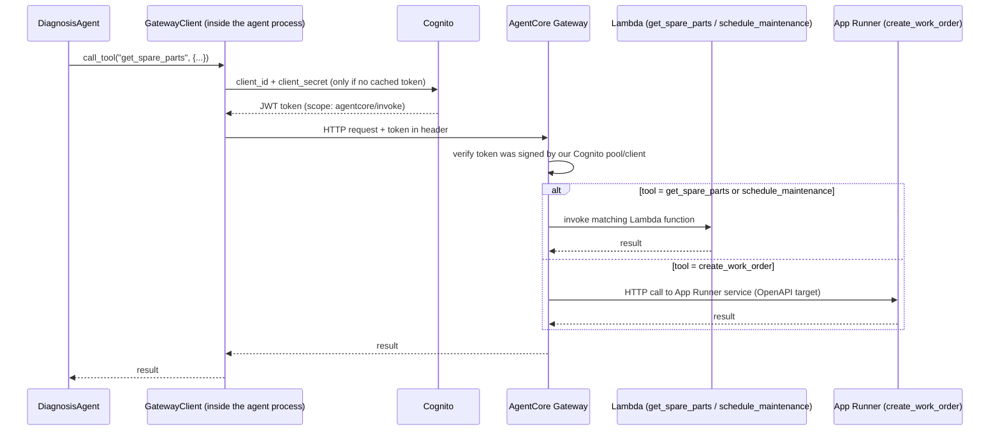

# Cognito + AgentCore Gateway + MCP Tools — Setup Reference

This document explains how authentication (Cognito), the AgentCore Gateway, and the
MCP tools (Lambda/App Runner) fit together in this project, and the exact script order
used to provision them from scratch. Everything here is already deployed and shared for
the hackathon — see [HACKATHON_README.md](HACKATHON_README.md) before re-running anything.

## The big picture

Three separate, simple responsibilities:

- **Cognito** — hands out a signed token (a "badge") to whoever proves they have valid
  credentials. It never talks to your agent code otherwise.
- **AgentCore Gateway** — one single address agents call to reach any tool. It checks
  the badge Cognito issued, then forwards the request to the right backend.
- **MCP tools** — two plain Lambda functions (`get_spare_parts`, `schedule_maintenance`)
  and one plain FastAPI web app on App Runner (`create_work_order`). Nothing
  MCP-specific about their code; the Gateway is what makes them "MCP tools". Each tool
  is registered as its own target — the Gateway routes each call to the right backend
  by tool name, it's not a single fixed destination.

Only [src/agents/diagnosis_agent.py](src/agents/diagnosis_agent.py) actually
instantiates it (`self.gateway_client = GatewayClient()`, line 476) and calls tools
through it. `HealthAgent` imports the same `GatewayClient` class and declares
`self.gateway_client = None  # Lazy initialized`, but never calls `GatewayClient()` or
`call_tool()` anywhere in [src/agents/health_agent.py](src/agents/health_agent.py) —
so today it's diagnosis-agent-only in practice, not just by convention.

## Cognito — one User Pool, two different app clients (not two pools)

Both of the following live inside the **same** Cognito User Pool
(`COGNITO_USER_POOL_ID`) — it's one pool serving two unrelated purposes, which is what
makes it easy to conflate:

1. **End-user auth app client** — created by
   [scripts/cognito_setup.py](scripts/cognito_setup.py) via
   [scripts/main_setup.py](scripts/main_setup.py): a public app client + test user for
   password-based login (`ALLOW_USER_PASSWORD_AUTH`). **Not currently used anywhere in
   `src/dashboard/` or the orchestrator** — provisioned but no login flow is wired in.
2. **Machine-to-machine (agent → Gateway) app client** — added to that *same* pool by
   [scripts/setup_cognito_token_flow.py](scripts/setup_cognito_token_flow.py) (it reads
   the existing `COGNITO_USER_POOL_ID`, it does not create a new pool): a resource
   server with scope `agentcore/invoke`, a hosted-UI domain (just to get an
   `/oauth2/token` endpoint), and a confidential app client (`client_credentials` grant).
   This script then **overwrites** `COGNITO_APP_CLIENT_ID`/`COGNITO_APP_CLIENT_SECRET`/
   `COGNITO_TOKEN_ENDPOINT`/`COGNITO_SCOPE` in `.agentcore.env` with this new client's
   values. This is what [src/gateway/client.py](src/gateway/client.py)'s `GatewayClient`
   actually uses.

**Why the Gateway trusts this specific client**: when
[scripts/create_agentcore_gateway_starter.py](scripts/create_agentcore_gateway_starter.py)
creates the Gateway, it builds a `customJWTAuthorizer` block —
`{"allowedClients": [COGNITO_APP_CLIENT_ID], "discoveryUrl": "https://cognito-idp.<region>.amazonaws.com/<pool_id>/.well-known/openid-configuration"}`
— and passes it straight into `create_mcp_gateway()`. Because it reads
`COGNITO_APP_CLIENT_ID` from `.agentcore.env` **after** step 5 (M2M client) has already
overwritten it, the Gateway ends up trusting the M2M client, not the end-user client.
This authorizer is the entire authentication mechanism on the Gateway side — it just
checks "was this JWT signed by our pool, for this one allowed client ID", it never
calls Cognito itself at request time (the discovery URL/JWKS is only used to validate
the token's signature).

**Ordering rule** (from `setup_cognito_token_flow.py`'s own docstring): after creating/
changing the confidential client, you must **recreate the Gateway** (so its
`allowedClients` list includes the new client ID) and **re-register the tools**.

## Script running order (from-scratch setup)

This is scoped strictly to what's needed for the Cognito → Gateway → MCP tools chain
itself. General project bootstrap scripts that exist in the repo but aren't part of
this specific chain are listed separately below, so they don't get conflated with it.

| # | Script | Purpose |
|---|---|---|
| 1 | `scripts/cognito_setup.py` | Creates the Cognito User Pool (the one pool used for both purposes above), a test user, and the end-user public app client. |
| 2 | `scripts/setup_cognito_token_flow.py` | Adds the **M2M** resource server (`agentcore/invoke` scope), hosted-UI domain, and confidential app client to that same pool. Overwrites `.agentcore.env`'s `COGNITO_APP_CLIENT_ID`/`SECRET`/`TOKEN_ENDPOINT`/`SCOPE` with this new client's values — this is what `GatewayClient` and the Gateway's authorizer both end up using. |
| 3 | `scripts/setup_dynamodb_for_mcp_tools.py` | Creates `maintenance_schedules` and `work_orders` DynamoDB tables that the tools themselves read/write. |
| 4 | `scripts/setup_s3_for_mcp_tools.py` | Creates the S3 bucket for MCP tool data files and uploads `data/mcp-tools/*.json`. |
| 5 | `scripts/deploy_mcp_lambdas.py` | Deploys the two Lambda-backed tools (`get_spare_parts`, `schedule_maintenance`): creates `MCPToolsLambdaRole` (with permission boundary), zips/deploys the handler code, sets env vars, test-invokes. |
| 6 | `scripts/create_apprunner_ecr_pull_role.py` | Creates the IAM role App Runner uses to pull images from ECR (`apprunner-ecr-pull-role`). |
| 7 | `scripts/push_create_work_order_to_ecr.sh` | Builds/pushes the `create_work_order` FastAPI service image to ECR. |
| 8 | `scripts/deploy_create_work_order_apprunner.sh <ECR_IMAGE_URL> <ECR_PULL_ROLE_ARN> <PROFILE>` | Creates the App Runner service running that image (port 8000). Get its public URL afterward via `aws apprunner describe-service`. |
| 9 | `scripts/create_agentcore_gateway_starter.py` | Creates the AgentCore Gateway itself: builds the `customJWTAuthorizer` config from the Cognito M2M client (step 2), creates `AgentCoreGatewayExecutionRole`, calls `GatewayClient.create_mcp_gateway()`. Writes `gateway_info.json`. **Must run after step 2**, and again any time the M2M client changes. |
| 10 | `scripts/register_mcp_tools_starter.py` | Registers all 3 tools onto the Gateway: `get_spare_parts`/`schedule_maintenance` as Lambda targets (by ARN + JSON schema from `tools/schemas/`), `create_work_order` as an HTTP/OpenAPI target (by URL). **Must run after steps 3-9.** |

### General project setup (not part of this chain — listed here only to avoid confusion)

| Script | Why it's out of scope here |
|---|---|
| `scripts/main_setup.py` | Orchestrates `iam_setup.py` → `cognito_setup.py` → `dynamodb_setup.py` as one general bootstrap step, not specific to the Gateway/MCP flow. |
| `scripts/iam_setup.py` | Creates general-purpose IAM roles (agent execution role, ECS task role) — the Gateway and Lambda tools each create their own dedicated roles separately (`AgentCoreGatewayExecutionRole`, `MCPToolsLambdaRole`). |
| `scripts/dynamodb_setup.py` | Creates the conversation-memory table used by the agents' chat history, unrelated to the MCP tools' own `maintenance_schedules`/`work_orders` tables. |
| `scripts/setup_s3_synthetic_data.py` | Creates/uploads the synthetic **device** data bucket (`agentic-ai-poc-synthetic-data`) that agents read from for reasoning — this has nothing to do with Cognito, the Gateway, or the MCP tool bucket (`setup_s3_for_mcp_tools.py`), it just happens to also be an S3 setup script. |

## Diagnostic / maintenance scripts (not part of the create order)

| Script | Purpose |
|---|---|
| `scripts/list_cognito_pools_and_clients.py` | Lists all Cognito User Pools + app clients in the account/region — useful to find IDs without going to the console. |
| `scripts/check_cognito_app_client_oauth.py` | Checks an app client's OAuth flow/scope/callback-URL config is correct for AgentCore Gateway auth. |
| `scripts/fix_cognito_app_client_oauth.py` | Repairs an app client's OAuth settings (enables Authorization Code Grant, required scopes, callback/logout URLs) if `check_cognito_app_client_oauth.py` finds a problem. |

## Adding a brand-new MCP tool later

Only need a subset of the above, in this order: deploy the new backend (Lambda via
`deploy_mcp_lambdas.py`-style code, or an HTTP service via the App Runner scripts) →
add its JSON schema under `tools/schemas/` → re-run
`scripts/register_mcp_tools_starter.py` with a new `register_lambda_tool()`/
`register_http_tool()` call added for it. No need to touch Cognito or recreate the
Gateway — those only change when the M2M app client itself changes.
