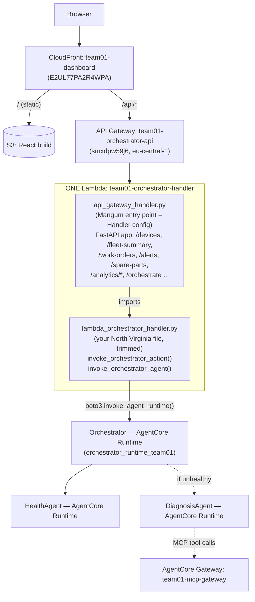
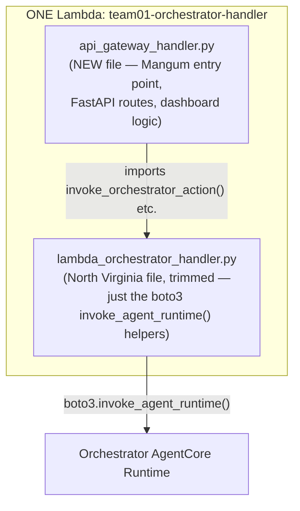

# Frankfurt Dashboard/Lambda Architecture — Current State & Simplification Plan

**Status:** Investigation complete, verified against live AWS resources (`eu-central-1`,
account `450410489798`) on 2026-08-28. No code changed yet — this is the reference
document before implementation begins.

---

## 1. Quick comparison: North Virginia (old) vs Frankfurt (current)

| | North Virginia (`event/hackathon-team01-backup-26_08_2026`) | Frankfurt (`event/hackathon-team01`) |
|---|---|---|
| Region | us-east-1 | eu-central-1 |
| Frontend | Local dashboard only (no CloudFront) | CloudFront + S3 + React |
| API Gateway | Separate REST API (e.g. `mn6y8y0u26...`) | `team01-orchestrator-api` (`smxdpw59j6`) |
| Lambda entry point | `lambda_orchestrator_handler.lambda_handler` (raw, one file) | `api_gateway_handler.handler` (FastAPI + Mangum) |
| Routes | `GET /orchestrate/devices`, `/orchestrate/devices/{id}`, `/orchestrate/devices/{id}/summary`, `POST /orchestrate` | `GET /devices`, `/devices/{id}`, `/devices/{id}/summary`, `/fleet-summary`, `/work-orders`, `/maintenance-schedule`, `/alerts`, `/spare-parts`, `/analytics/*`, `POST /orchestrate` |
| Number of Lambda functions (dashboard+orchestrator part only) | 1 | 1 |

**Key fact:** `functions/api_gateway_handler.py` never existed on the North Virginia
branch. It was introduced in Frankfurt by commit `a46351f "refactor: separate FastAPI
gateway from orchestrator handler"`, which split the old single-file handler in two.

---

## 2. Current Frankfurt architecture (verified live)



### Only ONE Lambda function exists for this part of the stack
No "two chained Lambdas." `team01-orchestrator-handler` is the only function; its
deployment zip contains two Python files that divide responsibility:

- **`functions/api_gateway_handler.py`** — the actual configured entry point
  (`Handler = api_gateway_handler.handler`, a Mangum-wrapped FastAPI app). Owns all
  HTTP routing and the dashboard-facing response shaping.
- **`functions/lambda_orchestrator_handler.py`** — the same file/lineage you used in
  North Virginia, but trimmed down. Its `lambda_handler`/`handle_get_request`/
  `create_response` functions are now dead code (not the entry point anymore). What's
  still actively used: `invoke_orchestrator_action()`, `invoke_orchestrator_agent()`,
  `parse_api_gateway_event()` — imported directly into `api_gateway_handler.py` and
  called for every route. This is what actually calls
  `boto3.invoke_agent_runtime()` against the Orchestrator.

### The API Gateway was not removed
`team01-orchestrator-api` (`smxdpw59j6`) is alive and does double duty: dashboard API
+ orchestrator bridge. It's a genuinely different, new API Gateway from the old North
Virginia one (different region, different resources) — it did not carry over 1:1.

### Live API Gateway resources (confirmed via `aws apigateway get-resources`)
```
/            -> ANY
/orchestrate -> OPTIONS, POST
/{proxy+}    -> ANY   (catches all other paths -> routed into the FastAPI app)
```

---

## 3. Where the sensor/health data actually comes from

- S3 bucket: `agentic-ai-poc-synthetic-data` (shared across teams), prefix `devices/`
  → `s3://agentic-ai-poc-synthetic-data/devices/{device_id}.json`
  (confirmed via the live Orchestrator Runtime's `SYNTHETIC_DATA_BUCKET` env var).
- Each file is a ~30-day time series of simulated readings, generated by
  `src/data/equipment_simulator.py`. Each entry already carries a pre-baked
  `health_state`/`degradation_score` "ground truth" label alongside the sensor
  `readings` (rpm, current, temperature, voltage, power_factor, vibration for a MOTOR).
- `list_devices`/`get_device_summary` just read this pre-baked label straight from
  storage — no agent computation involved (deliberate: cheap enough to poll
  constantly for a device list/table).
- `get_device` / `analyze` re-computes health for real via
  `src/agents/health_agent.py`'s `_compute_degradation_score()`, then runs the full
  HealthAgent → DiagnosisAgent workflow — this is where genuine agent reasoning and
  MCP tool calls happen.
- Dashboard display: shown as an inverted "Health %" bar on device cards
  (`health = (1 - degradation_score) * 100`), and directly as "Avg Degradation" on the
  Analytics tab.

---

## 4. Connecting a local dashboard to Frankfurt for a demo

Confirmed via live curl tests against `smxdpw59j6`:

| URL | Result |
|---|---|
| `GET /prod/orchestrate/devices` (old North-Virginia-style nested path) | **404** |
| `GET /prod/devices` (current flat path) | **200 OK** |
| `GET /prod/health` | **200 OK** |

So the local dashboard's `ORCHESTRATOR_URL` must point at the **stage root**, without
the old `/orchestrate` suffix:
```
ORCHESTRATOR_URL=https://smxdpw59j6.execute-api.eu-central-1.amazonaws.com/prod
```
`src/dashboard/config.py` already uses this Frankfurt stage root as its default, so no
environment variable is required unless a different backend is wanted.

The **stage root** is the deployed API Gateway base URL through `/prod`, before any
endpoint path. The local dashboard appends its endpoint paths to this value:

```text
https://smxdpw59j6.execute-api.eu-central-1.amazonaws.com/prod/devices
https://smxdpw59j6.execute-api.eu-central-1.amazonaws.com/prod/health
```

Do not append `/orchestrate` to `ORCHESTRATOR_URL`. Frankfurt uses flat routes for
dashboard data (`/devices`, `/fleet-summary`, `/alerts`, `/work-orders`, and others).
`POST /orchestrate` remains available as a separate endpoint for generic orchestrator
requests; it is not a prefix for the dashboard routes. North Virginia used the older
`/orchestrate/devices` route pattern, which Frankfurt no longer supports.

---

## 5. Is `lambda_orchestrator_handler.py` the same file from North Virginia? How many Lambda functions total?

### Is `lambda_orchestrator_handler.py` the same file from North Virginia?

**Yes, same file/lineage** — but trimmed down. In North Virginia, this ONE file did
*everything*: HTTP routing (`lambda_handler`, `handle_get_request`, `create_response`)
**and** the actual `boto3.invoke_agent_runtime()` call to the Orchestrator.

When it was refactored for Frankfurt (`git log` shows a commit literally titled
*"refactor: separate FastAPI gateway from orchestrator handler"*, `a46351f`):
- **Kept** the "talk to AgentCore Runtime" parts in this same file:
  `invoke_orchestrator_agent()`, `invoke_orchestrator_action()`,
  `parse_api_gateway_event()` — this is the logic recognizable from North Virginia,
  basically unchanged.
- **Moved out** the "talk to API Gateway/HTTP routing" parts (`lambda_handler`,
  `handle_get_request`, `create_response`) into a brand-new file,
  `api_gateway_handler.py`, rewritten using FastAPI.

So `lambda_orchestrator_handler.py`'s own `lambda_handler` function still physically
exists in the file but is **dead code now** — it's not the Lambda's entry point
anymore, and nothing calls it.

### How many Lambda functions total (for this part — not MCP tools)?

**Just ONE** — `team01-orchestrator-handler`. That single Lambda's deployment package
(zip) contains **both** Python files working together:



- `api_gateway_handler.py` = the "front door" (this is what AWS actually invokes —
  `Handler = api_gateway_handler.handler`).
- `lambda_orchestrator_handler.py` = a library/helper module imported by the front
  door — it's what actually reaches the Orchestrator agent, same as before.

No hidden second Lambda anywhere in this part of the flow — it's one function, two
files, one clearly the "router+dashboard logic," the other the "AgentCore bridge"
already familiar from North Virginia. This is exactly the split to keep in the
simplified version — clean up what's *inside* `api_gateway_handler.py` (replace the
fabricated bits) rather than introduce any additional Lambda.

### Terminology: `team01-orchestrator-handler` is a resource name, not a file

`team01-orchestrator-handler` is the **name of the deployed AWS Lambda function**,
not a source file. A Lambda function is a named cloud resource whose code package
(a zip file) can contain any number of `.py` files; the function name is assigned
at deploy time and is independent of the filenames inside the package. The
`LAMBDA["ONE Lambda: team01-orchestrator-handler"]` box in the diagram above
represents this deployed function as a container, with the two `.py` files as
its contents — not two separate deployables.

The `.py` filenames stay generic across teams — every team's deployment package
contains files named `api_gateway_handler.py` and `lambda_orchestrator_handler.py`.
The team prefix is applied only to the **AWS resource names** (Lambda function
name, IAM role name, REST API name) at deploy time:

| Deploy script | Function name | Parameterization |
|---|---|---|
| `scripts/deploy_lambda_api_gateway_boto3.py` (old) | `"team01-orchestrator-handler"` | Hardcoded string literal |
| `scripts/deploy_lambda_api_gateway_fastapi.py` (current) | `f"{team_id}-orchestrator-handler"` | Driven by `--team-id` |

The same pattern applies to the IAM role (`<team_id>-lambda-execution-role`) and
REST API (`<team_id>-orchestrator-api`) created by the current script.

### File/script usage reference

| File | Status |
|---|---|
| `functions/api_gateway_handler.py` | In use — the Lambda entry point (`Handler = api_gateway_handler.handler`) |
| `functions/lambda_orchestrator_handler.py` | In use, partially — only `invoke_orchestrator_agent`, `invoke_orchestrator_action`, and `_invoke_orchestrator_runtime` are imported and called. `lambda_handler`, `handle_get_request`, and `create_response` were dead code and were removed during the dashboard-data fix. |
| `scripts/deploy_lambda_api_gateway_boto3.py` | Not used for this stack. It only wires `POST /orchestrate` and does not create the `{proxy+}` resource or set the FastAPI handler, so its output does not match the live configuration. |
| `scripts/deploy_lambda_api_gateway_fastapi.py` | The current deploy script for this Lambda + API Gateway. Its docstring states it "mirrors the exact live team01 setup...verified via AWS CLI on 2026-08-28" — the live Lambda was originally created manually, and this script was written afterward to capture that configuration in a reproducible, team-parameterized form. |

Deploy command (documented as step 7 in `TEAM_ONBOARDING_STEPS.md`):

```bash
python scripts/deploy_lambda_api_gateway_fastapi.py --team-id <team> --region <region> --profile <profile>
```

Prerequisites (not created by this script):
- `agent_endpoints.<team_id>.json` must exist (produced by step 6, `deploy_to_agentcore_boto3.py`).
- The `<team_id>-conversation-memory` DynamoDB table and `<team_id>-synthetic-data`
  S3 bucket must already exist — referenced by the IAM policy this script attaches,
  but not created by it (open onboarding gap, see "Known gaps" in
  `TEAM_ONBOARDING_STEPS.md`).

**So the script to run for this part of the setup (Lambda + API Gateway together)
is `scripts/deploy_lambda_api_gateway_fastapi.py --team-id <team> --region <region>
--profile <profile>`** (documented as step 7 in `TEAM_ONBOARDING_STEPS.md`). It
needs `agent_endpoints.<team_id>.json` to already exist (from step 6,
`deploy_to_agentcore_boto3.py`), and the `<team_id>-conversation-memory` DynamoDB
table / `<team_id>-synthetic-data` S3 bucket to already exist (referenced by its
IAM policy, not created by this script — still an open onboarding gap).


## 6. Operational considerations

The CloudFront deployment path has operational tradeoffs for hackathon participants:

Deploy/iteration loop is slow and manual:

Any frontend change requires: npm build → sync to S3 → CloudFront cache invalidation → wait for propagation (minutes, not seconds). Compare to local dashboard: save file, refresh browser.
Any Lambda change requires re-zipping and update-function-code, plus the API Gateway {proxy+} resource and Handler value were set up manually outside any script — a participant who needs to add a new route or fix something has to know AWS API Gateway console mechanics, not just edit Python.
Debugging is harder:

Errors surface as generic Lambda/API Gateway 500s; root cause requires digging through CloudWatch Logs, cold-start behavior, and IAM permission errors that look identical to code bugs.
Locally, a stack trace prints directly in the terminal.
More moving parts to reason about:

Two-layer Lambda handler (api_gateway_handler.py wrapping lambda_orchestrator_handler.py via Mangum) adds an ASGI-to-Lambda-event translation layer participants must understand just to trace a request.
Requires separate toolchains: Python (backend/agents) and Node/npm/React (frontend) and AWS CLI/console (infra) — vs. just Python for the local dashboard.
No reliable "reset button":

Since the live config drifted from any deploy script, there's no confident way to tear down and recreate it if something breaks mid-hackathon — a participant could get stuck without AWS console expertise.
So my view holds: even post-fix, the CloudFront path adds real friction for anyone other than someone deeply familiar with this specific AWS setup. The local dashboard (same real agents/backend, simpler frontend loop) is the safer choice for a time-boxed hackathon with multiple participants.

---

## 7. Dashboard-data fix (branch `event/hackathon-team01-cloudfront-dashboard-fix`)

Applied on top of `event/hackathon-team01`, keeping the one-Lambda/two-file split
from section 7 (no new infrastructure).

### Code changes

- **`functions/api_gateway_handler.py`**
  - Added `_get_analyzed_devices()`: calls `action="get_device"` (the real
    HealthAgent → DiagnosisAgent workflow) once per device and caches the results
    in-memory for 300s (module-level, survives warm Lambda re-invocations) — avoids
    re-running the full agent workflow for every dashboard poll.
  - Added `extract_work_orders()`, `extract_maintenance_schedules()`,
    `extract_spare_parts()` — ported from `src/dashboard/routes/api.py` so both
    frontends read `tool_results` the same way.
  - Rewrote `/work-orders`, `/maintenance-schedule`, `/alerts` to build their
    responses from `_get_analyzed_devices()` + the extractors above, instead of
    fabricating values from the pre-baked `health_state` label.
  - `/fleet-summary` now populates `work_orders`/`maintenance_schedules`/
    `spare_parts` from the same cached analysis instead of hardcoded empty lists,
    while still using the fast `list_devices` path for health counts.
  - `/cache-clear` now actually invalidates `_ANALYSIS_CACHE` before recomputing.
  - Removed a duplicate `POST /orchestrate` route registration and the unused
    `parse_api_gateway_event` import.
- **`functions/lambda_orchestrator_handler.py`**
  - Removed dead code: `lambda_handler`, `handle_get_request`, `create_response`,
    `parse_api_gateway_event`, and the `__main__` test block — none of these were
    reachable anymore since `api_gateway_handler.py` is the real entry point.
    Kept `invoke_orchestrator_agent`, `invoke_orchestrator_action`,
    `_invoke_orchestrator_runtime` (still actively used).
  - Updated the module docstring to describe its current role (bridge library,
    not the Lambda entry point).
- **`src/dashboard/config.py`**
  - Fixed the stale `ORCHESTRATOR_URL` default: was
    `https://mn6y8y0u26.execute-api.us-east-1.amazonaws.com/prod/orchestrate`
    (old North Virginia host + path), now
    `https://smxdpw59j6.execute-api.eu-central-1.amazonaws.com/prod` (live
    Frankfurt API Gateway, flat route convention — confirmed via live curl tests
    in section 5).

### Files removed (confirmed unused, not referenced anywhere else in the repo)

- `infra/dashboard-api.yaml` + `scripts/deploy_dashboard_api.py` — the separate
  Dashboard API Lambda tier that was written but never deployed (no matching
  CloudFormation stack exists).
- `functions/template.yaml.bak` — leftover SAM template backup, superseded by the
  boto3-based deploy scripts, not referenced by anything.

### Deliberately left unchanged

- `scripts/deploy_lambda_api_gateway_boto3.py` still doesn't match the live
  Handler/`{proxy+}` config — fixing that script is a separate,
  larger task (making the deploy reproducible) and wasn't part of this fix.
- CloudFront/S3/React app itself, `scripts/deploy_cloudfront.py`,
  `infra/cloudfront-dashboard.yaml` — untouched.
### Deployment status

**Deployed and verified live**, confirmed on 2026-08-30 via:
- `aws lambda get-function` — `LastModified: 2026-08-28T11:26:36.000+0000`, matching
  when this fix was completed.
- `aws logs tail /aws/lambda/team01-orchestrator-handler` — shows real per-device
  `get_device` analysis calls (not the old fabricated single-string-match pattern),
  the 300s in-memory cache behaving as designed (a ~31s cold call followed by a
  ~2ms cached repeat), and zero errors.
- A live curl test against every route on the `prod` stage.

All items in this section (code changes, removed files, redeploy, curl verification)
are complete.