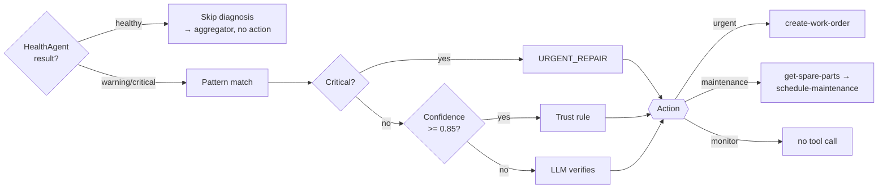
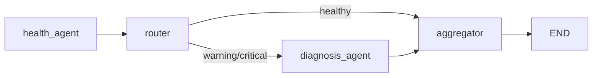
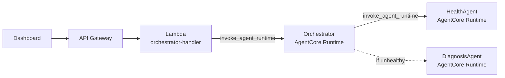
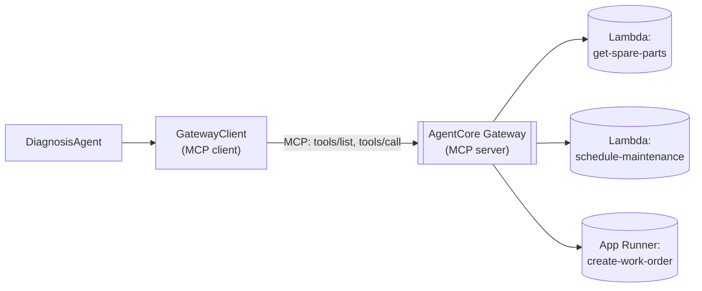

# AI-Powered Predictive Maintenance
## Multi-Agent System — Hackathon Kickoff

Team01 · 2026-08-26

<!--
Speaker note: ~15-20 min total including demo. Keep each slide to 60-90s.
-->

---

## Agenda (~20 min)

1. What we're building — 2 min
2. Architecture: multi-agent + LangGraph — 5 min
3. Two ways to run it: Docker Compose vs AgentCore Runtime — 3 min
4. AgentCore Gateway + MCP tools + Cognito deep dive — 3 min
5. Adding your own agent — 3 min
6. Live demo — 5-7 min
7. Your task + resources — 2 min

---

## The problem

- Industrial IoT devices (pumps, motors) stream sensor data
- We want it to **autonomously**:
  1. Classify device health
  2. Diagnose the root cause if something's wrong
  3. Take action — find spare parts, schedule maintenance, open a work order
- No human in the loop for the routine cases

---

## System architecture: end-to-end decision flow



This is the full path for every device: healthy devices skip diagnosis entirely
(cost optimization); unhealthy devices go through rule-based diagnosis, LLM fallback
only when needed, and whichever external tool ends up getting called as a result
*(how that tool call actually works is covered later)*.
*If parts aren't available, `get-spare-parts` falls back to `create-work-order`
(procurement) instead of `schedule-maintenance`. Source: `ARCHITECTURE.md`.*

---

## Why multi-agent + why LangGraph

- Each agent has **one job** — testable in isolation
- LangGraph gives a **deterministic graph** (`StateGraph`) instead of ad-hoc if/else chains
- **Conditional routing** = skip the expensive diagnosis step for healthy devices (cost optimization)
- The graph topology is identical locally and on AWS — only *how nodes talk to each other* changes (HTTP vs `boto3.invoke_agent_runtime()`)

<!-- src/graph/workflow.py -->

---

## The agent graph (LangGraph)

Every device reading flows through the same 4-node graph, locally or on AWS:



*Source: `ARCHITECTURE.md` — "The agent graph (LangGraph)". Same topology whether
running locally (`src/graph/workflow.py`) or on AWS (`src/graph/workflow_agentcore.py`)
— only the transport between nodes differs (HTTP vs `boto3.invoke_agent_runtime()`).*

---

## The graph itself

`src/graph/workflow.py`

- **Nodes:** `health_agent` → `router` → `{end | diagnosis_agent}` → `aggregator` → `END`
- **Shared state** (`WorkflowState` TypedDict): `device_id`, `health_status`, `diagnosis`, `tool_results`, `agents_used`, `mcp_tools_used`
- Graph is built once in `_build_graph()` (~L88-L119) and reused for every request

---

## Orchestrator

`src/services/orchestrator/app.py` (FastAPI wrapper around `src/graph/workflow.py`)

- Not a diagnosis "brain" itself — it **runs the LangGraph workflow**: calls HealthAgent, conditionally calls DiagnosisAgent, then aggregates the final response
- The **only** service with a public interface — direct URL locally, Lambda + API Gateway on AWS
- Tracks `agents_used` / `mcp_tools_used` per request — this is what powers the dashboard's "which agents/tools ran" tracing view


---

## HealthAgent

`src/agents/health_agent.py`

- **No LLM, no tools** — pure threshold-based rules
- Compares sensor readings against `normal_range`
- Computes a `degradation_score`
- Output: `healthy` / `warning` / `critical`

*Runs on every device, every time — has to be fast and cheap.*

---

## DiagnosisAgent

`src/agents/diagnosis_agent.py` — only runs for unhealthy devices, 4 steps:

1. **Pattern matching** — equipment-specific rules → confidence score
2. **Critical override** — `critical` health forces `URGENT_REPAIR` regardless of rule confidence
3. **LLM fallback** — only if confidence `< 0.85` (Bedrock `nova-lite` — cost control)
4. **Act** — calls out to external tools (spare parts / schedule maintenance / create work order)
   *— mechanics covered later, once we've introduced AgentCore*

---

## Two ways to run the same graph

| | Local (Docker Compose) | AWS (AgentCore Runtime) |
|---|---|---|
| Entry point | FastAPI `app.py` | `BedrockAgentCoreApp` `handler.py` |
| Agents talk via | HTTP over docker network | `boto3.invoke_agent_runtime()` |
| Ports | 8000 / 8001 / 8002 | 8080 (all) |
| Workflow file | `src/graph/workflow.py` | `src/graph/workflow_agentcore.py` |
| Public interface | direct orchestrator URL | Lambda + API Gateway |
| AWS resources | **real** (Bedrock, Gateway, Cognito, DynamoDB, S3) | same, real |
| Isolation | none needed | namespaced by `TEAM_ID` |

---

## Local: Docker Compose

```bash
docker-compose up -d --build
curl http://localhost:8000/health
ORCHESTRATOR_URL=http://localhost:8000 python3 -m src.dashboard.app
# open http://localhost:8080
```

- 3 services: `orchestrator` (8000), `health-agent` (8001), `diagnosis-agent` (8002)
- Mounts `~/.aws` read-only — **this is not a mock**, it calls real shared AWS infra

---

## AWS Bedrock AgentCore — the building blocks

AWS's managed platform for running AI agents in production (framework-agnostic —
works with LangGraph, CrewAI, Strands, plain code, etc.):

- **Amazon Bedrock AgentCore Runtime** — serverless hosting for an agent: your container, one HTTP contract (`/invocations`, `/ping`), session-isolated microVMs, scales to zero
- **Amazon Bedrock AgentCore Gateway** — turns existing APIs/Lambdas into MCP-compatible tools automatically, with built-in auth — no hand-written MCP server needed
- **Amazon Bedrock AgentCore Memory** — managed short-term (session) + long-term (cross-session) memory for agents, so you don't build your own memory store
- **Amazon Bedrock AgentCore Observability** — unified traces/logs per agent invocation via CloudWatch (GenAI Observability) — see exactly what an agent did on a given request

*We use Runtime + Gateway today; Memory is planned; Observability is built-in and I'll show it live.*

---

## AWS: AgentCore Runtime

1. Build **ARM64** images, push to ECR (tagged with `TEAM_ID`)
2. `scripts/deploy_to_agentcore_boto3.py` registers each as its own AgentCore Runtime
3. Agents call each other via `boto3.invoke_agent_runtime()`, not HTTP
4. A Lambda + API Gateway front the orchestrator for public/dashboard access
5. Everything namespaced by `TEAM_ID` so teams sharing the account don't collide

*Full steps: `HACKATHON_README.md`*

---

## Why AgentCore Runtime

- **Fully managed** — no servers to patch/scale, AWS runs the container for you
- Each session runs in its **own isolated microVM** — no cross-session state leakage, and it's torn down when idle (pay only for real usage)
- **Simple contract**: `BedrockAgentCoreApp` just needs `POST /invocations` + `GET /ping` on port 8080 — same shape as any normal web service, no custom protocol to learn
- Same code, two ways to run it — moving from Docker Compose to AWS only changed *transport* (HTTP → `boto3.invoke_agent_runtime()`); the agent logic itself (`src/agents/*.py`) never changed
- Native neighbors in the same ecosystem: **Gateway** (tools), **Identity/Cognito** (auth), **Memory**, **Observability** — no separate glue code needed to wire them together

---

## AgentCore Runtime — production request flow



- Only the **Orchestrator** has a public Lambda + API Gateway in front of it
- HealthAgent/DiagnosisAgent are **never called directly** — only reached as nested `invoke_agent_runtime` calls made from inside the Orchestrator's own LangGraph workflow
- DiagnosisAgent is the one that additionally calls out to the **AgentCore Gateway** for MCP tools — next up

*Source: `ARCHITECTURE.md` — "Production request flow (AWS)".*

---

## Cognito + AgentCore Gateway — who does what

- **Cognito** — the identity provider. Issues a signed token (machine-to-machine,
  `client_credentials` grant — no human login involved) proving the agent is
  allowed to call tools
- **AgentCore Gateway** — the single address every agent talks to for tools. It
  checks the Cognito token, then *is* the MCP server: it speaks the standard
  MCP interface (`tools/list` to discover what's available, `tools/call` to
  invoke one)
- **`GatewayClient`** (inside `DiagnosisAgent`, `src/gateway/client.py`) is the
  **MCP client** — the one piece of our code that actually speaks this protocol
- **Shared infrastructure** — used identically by Docker Compose (local) and
  AgentCore Runtime (AWS) agents; not something that only appears once you
  deploy to AWS

---

## Where the tools actually live

The Gateway doesn't run the tools itself — it routes each call, by tool name,
to a real backend. None of these backends have any MCP-specific code; the
Gateway is what makes them "MCP tools":

| Tool name | Real backend |
|---|---|
| `get_spare_parts` | AWS Lambda |
| `schedule_maintenance` | AWS Lambda |
| `create_work_order` | App Runner (plain FastAPI service) |



Full deep-dive: **`COGNITO_GATEWAY_MCP_SETUP.md`**

---

## AgentCore Memory + Observability

**Memory** *(in progress — not fully wired into the deployed Runtime yet)*
- Goal: give agents cross-invocation context — e.g. don't create a duplicate work order for the same fault twice, spot degradation trends across repeated checks
- Today: only powers a read-only `memory_context` field in the local dashboard; the deployed Runtime path doesn't construct a `MemoryClient` yet

**Observability** *(I'll show a couple of things live)*
- Every AgentCore Runtime automatically ships logs to CloudWatch: `/aws/bedrock-agentcore/runtimes/<runtime_id>-DEFAULT`
- Trace spans are available too (GenAI Observability / Transaction Search) — useful for seeing exactly which node/tool a request touched

---

## Adding your own agent — 4 pieces

1. **Agent class** — inherit `BaseAgent`, implement `execute()` (`src/agents/base_agent.py`)
2. **Two wrappers** — FastAPI `app.py` (local) + `BedrockAgentCoreApp` `handler.py` (AWS)
3. **One node + edge** in `src/graph/workflow.py` (and mirror in `workflow_agentcore.py`)
4. **One service block** in `docker-compose.yml` + a `Dockerfile`

**Fastest path:** copy `src/agents/health_agent.py` (simplest agent — no LLM, no tools) as your starting template.

---

## Live demo — what I'll show

1. `docker-compose ps` — all services healthy
2. Swagger UI (`/docs` on each service — 8000/8001/8002) — check endpoints directly, no dashboard needed
3. Dashboard (`http://localhost:8080`) — fleet-wide device status, drill into a specific device's readings/diagnosis, and tracing of which agents + LLM calls ran for a request
4. Switch `ORCHESTRATOR_URL` to our deployed **AgentCore Runtime** endpoint (via the Lambda + API Gateway) and reload the same dashboard — same UI, same code, now backed by AWS-hosted agents instead of Docker containers

---

## Resources

- `HACKATHON_README.md` — setup + AgentCore deploy steps
- `COGNITO_GATEWAY_MCP_SETUP.md` — auth/gateway/tools deep dive + script order
- `ARCHITECTURE.md` — full system design
- `README.md` — general project overview

## Questions?
