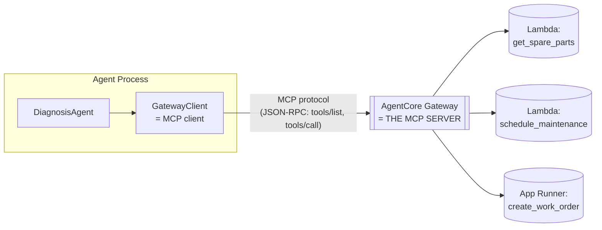
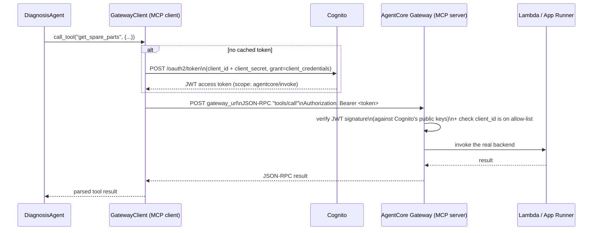
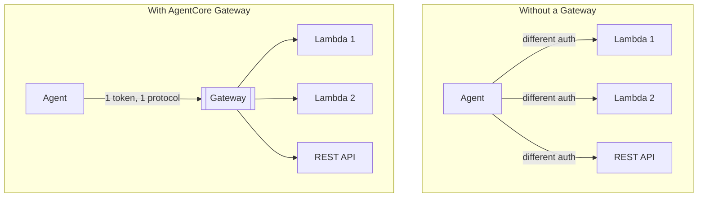

# Lecture Notes: AgentCore Gateway, MCP Tools & Cognito OAuth
*(How agents securely call tools in this project)*

---

## 1. The One-Sentence Version

> An agent gets a **badge** from **Cognito**, shows the badge to the **AgentCore Gateway**,
> and the Gateway — which *is* the MCP server — routes the call to the real tool
> (a Lambda function or a web service) and hands the answer back.

Three actors, three jobs, nobody does anyone else's job:

| Actor | Job | Analogy |
|---|---|---|
| **Cognito** | Issues a signed token to anyone with valid credentials | Security office issuing a badge |
| **AgentCore Gateway** | The single front door for *all* tools; checks the badge, forwards the request | Building reception desk |
| **MCP Tools** (Lambda / App Runner) | Do the actual work (check parts, create a work order...) | The departments inside the building |

---

## 2. Who is "the MCP server" here? (the question people always ask)

**The AgentCore Gateway is the MCP server.** Not the Lambda functions, not the App
Runner service.

- The Gateway exposes exactly two MCP methods over HTTP as JSON-RPC 2.0: **`tools/list`**
  and **`tools/call`**. That *is* the MCP protocol contract.
- The agent process (inside `DiagnosisAgent`) holds an **MCP client** —
  [`src/gateway/client.py`](src/gateway/client.py)'s `GatewayClient` — which speaks that
  protocol to the Gateway.
- The three backend tools (`get_spare_parts`, `schedule_maintenance`, `create_work_order`)
  are just **plain, ordinary code** — a Lambda function and a FastAPI app. There is
  **nothing MCP-specific in their own code at all**. They only *become* "MCP tools"
  because the Gateway registers them as **targets** and exposes them through its
  `tools/list` / `tools/call` interface.

**One-line summary to say out loud in class:**
*"The Gateway is the MCP server; the agent's `GatewayClient` is the MCP client; the
Lambda/App Runner tools are ordinary backends the Gateway fronts — they don't know or
care that MCP exists."*

---

## 3. Cognito OAuth — how the "badge" works

This project uses **one Cognito User Pool** but **two different app clients** inside it,
for two unrelated purposes. Don't confuse them:

| # | App client | Grant type | Used for | Used today? |
|---|---|---|---|---|
| 1 | End-user client | `USER_PASSWORD_AUTH` | Human login (username/password) | Created, but **not wired into the dashboard** |
| 2 | Machine-to-machine (M2M) client | `client_credentials` | Agent → Gateway calls | **Yes — this is the one that matters** |

The agent never uses a username/password. It's a **service-to-service** login:

**Key OAuth facts to teach:**
1. This is the **`client_credentials` grant** — the classic "app talking to app" OAuth
   flow (no human, no browser, no login page).
2. Cognito never talks to the Gateway directly. The Gateway only needs Cognito's
   **public signing keys** (via the discovery URL) to verify a token's signature —
   it does this locally, offline, on every request.
3. The Gateway trusts a token only if **both** are true:
   - it was signed by *this* Cognito User Pool, **and**
   - the `client_id` inside it is on the Gateway's allow-list (`allowedClients`).
4. The agent caches the token and refreshes it ~5 minutes before it expires, so it
   isn't fetching a new token on every single tool call.

---

## 4. Why put a Gateway in front of the tools at all?

Without a Gateway, every agent would need to know 3 different addresses, 3 different
auth mechanisms, and 3 different calling conventions (2 Lambdas + 1 REST API).

With the Gateway:
- **One address, one token type, one protocol (MCP/JSON-RPC)** for every tool.
- Adding a new tool later = register it on the Gateway. No agent code changes needed.
- Auth is centralized — the Gateway is the only thing that needs to verify tokens.

---

## 5. The 3 real tools in this project

| Tool (MCP name) | What it actually is | Where it stores data |
|---|---|---|
| `get-spare-parts` | AWS Lambda | Reads a fixed parts catalog from S3 |
| `schedule-maintenance` | AWS Lambda | Writes a row to DynamoDB `maintenance_schedules` |
| `create-work-order` | FastAPI app on App Runner (a normal HTTP web service) | Writes a row to DynamoDB `work_orders` |

Each is registered on the Gateway as its own **target**:
- Lambdas are registered by their ARN + a JSON input schema.
- The App Runner service is registered as an **OpenAPI/HTTP target** (by URL).

The Gateway picks the right target purely by **tool name** — `tools/call` includes the
tool name, and the Gateway routes accordingly. It is not one fixed destination.

---

## 6. End-to-end example (concrete walk-through for the talk)

1. `DiagnosisAgent` decides a pump needs preventive maintenance.
2. It calls `gateway_client.call_tool("get_spare_parts", {"part_type": "bearing"})`.
3. `GatewayClient`:
   - Has no valid cached token → POSTs to Cognito's `/oauth2/token` with
     `client_id` + `client_secret` + `grant_type=client_credentials`.
   - Gets back a JWT good for ~1 hour.
   - POSTs to the Gateway URL: `{"jsonrpc":"2.0","method":"tools/call","params":{"name":"get-spare-parts","arguments":{"part_type":"bearing"}}}`
     with `Authorization: Bearer <jwt>`.
4. Gateway verifies the JWT signature + allow-listed client, sees the tool name
   `get-spare-parts`, and invokes the matching Lambda.
5. Lambda reads the parts catalog from S3, returns whether a bearing is in stock.
6. Gateway wraps the Lambda's result as a JSON-RPC response and sends it back.
7. `GatewayClient` returns the parsed result to `DiagnosisAgent`, which decides:
   parts available → call `schedule-maintenance`; not available → call
   `create-work-order` instead.

---

## 7. Quick recap / cheat-sheet slide

- **Cognito** = badge issuer (OAuth `client_credentials` grant → JWT).
- **AgentCore Gateway** = the MCP server. Speaks `tools/list` / `tools/call` JSON-RPC.
  Checks the badge, routes by tool name.
- **GatewayClient** (inside the agent) = the MCP client. Gets tokens, caches/refreshes
  them, calls the Gateway.
- **The 3 tools** (2 Lambdas + 1 App Runner service) = plain backends with zero
  MCP-specific code. They only look like "MCP tools" because the Gateway fronts them.
- **One Cognito User Pool, two app clients** — only the machine-to-machine client
  (`client_credentials`) is actually used by agents today; the end-user/password
  client exists but isn't wired into anything yet.

---

## 8. Suggested slide breakdown (if presenting)

1. Title + the one-sentence version (section 1)
2. "Who is the MCP server?" reveal (section 2) — this is usually the most surprising
   answer for an audience new to MCP
3. Cognito OAuth flow diagram (section 3)
4. Why a Gateway at all — before/after diagram (section 4)
5. The 3 real tools table (section 5)
6. Walk through one real call end-to-end (section 6)
7. Recap slide (section 7)
